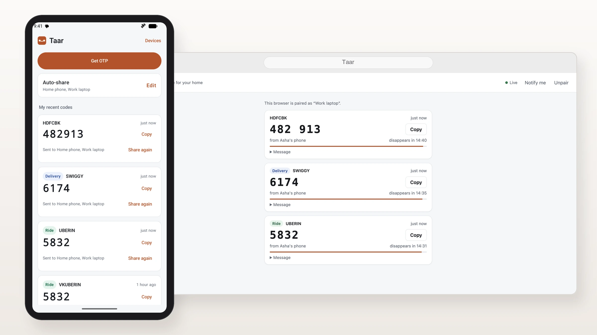

<p align="center">
  
</p>

<h1 align="center">SecureHome</h1>

<p align="center"><strong>A private, encrypted line for your home.</strong></p>

<p align="center">
  
</p>

SecureHome moves one-time codes from your Android phone's SMS to the devices you choose: a browser tab on your work
laptop, or another phone at home. Every code is end-to-end encrypted. The relay in the middle is a
small Cloudflare Worker you run yourself, and it can't read anything it carries.

- **Bank and card OTPs, delivery codes and ride PINs** are detected on the phone. Other messages never leave it.
- **The laptop needs nothing installed:** open the relay's page, scan its QR code with your phone, done.
- **Two phones, both ways:** each phone sends its codes to the devices you switch on, and can share
  any code from the last two days by hand.
- **No accounts.** Devices pair by QR code and a 6-digit confirmation code.

## How it works

```
  Phone (Android app)                Relay (your Cloudflare Worker)           Laptop (browser tab)
  ───────────────────                ──────────────────────────────           ────────────────────
  SMS arrives → OTP detected
  encrypt to each recipient ───────▶ one Durable Object per household ──────▶ decrypt, show code
  sign with this device's key        stores encrypted items ~15 minutes        verify the sender
                                     pushes them over WebSockets
```

| Part | Path | What |
| --- | --- | --- |
| Relay and laptop page | [`relay/`](relay/) | Cloudflare Worker + Durable Objects (SQLite). Serves the laptop page and the API. |
| Android app | [`android/`](android/) | Kotlin + Jetpack Compose. Reads SMS, detects codes, pairs devices, sends and receives. |
| Protocol | [`PROTOCOL.md`](PROTOCOL.md) | Wire format, crypto and API, shared by every client. |
| Test data | [`fixtures/`](fixtures/) | SMS samples for the OTP detector, and crypto vectors. |

## Run your own

**1. Deploy the relay**

```sh
cd relay
npm ci
npx wrangler login
npm run deploy                                # prints https://securehome.<your-subdomain>.workers.dev
openssl rand -base64 18                       # a founding code; keep it in your password manager
npx wrangler secret put FOUNDING_SECRET       # paste it
```

**2. Build and install the app**

```sh
cd android
./scripts/make-release-key.sh                 # once; back up ~/.securehome, it's the app's identity
echo "securehome.relay=https://securehome.<your-subdomain>.workers.dev" >> local.properties
./gradlew assembleRelease
adb install -r app/build/outputs/apk/release/app-release.apk
```

You can also host the APK directly on your relay website:
```sh
./scripts/build-apk.sh                        # copies APK to relay/public/securehome.apk
```

**3. Set up**

1. On the phone: enter the founding code and tap **Start household**. Allow SMS access.
2. On the laptop: open your relay's URL. On the phone: **Devices → Pair a device → Scan QR code**,
   check that both screens show the same code, and tap **They match**.
3. A second phone installs the same app, taps **Join a household**, and the first phone scans its code.

## Author

Created and maintained by **Tanmay Bhadre** (<tanmaybhadre6@gmail.com>).
Copyright &copy; 2026 Tanmay Bhadre. All rights reserved.
